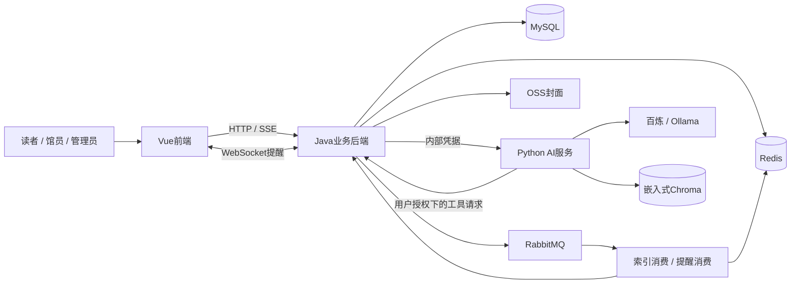
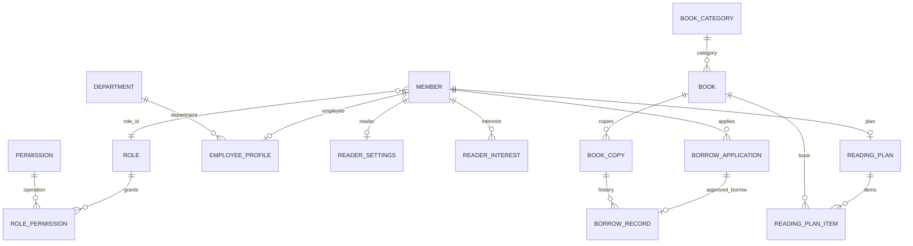
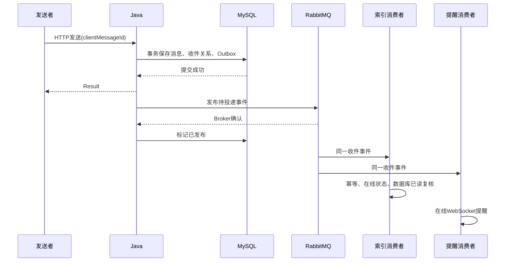

# 系统设计

## 架构与信任边界

Java拥有事务、身份、权限和业务数据的最终裁决权。Python负责对话、检索、候选重排和受控工具编排，不直接授予用户权限。外部模型可能接触任务必要内容，部署方需决定资料外发范围；API Key与JWT不能进入提示词或前端。

## 核心数据关系

关系图表达逻辑关联，不代表数据库外键。项目由Service验证关联，表上建立索引与唯一约束；管理员使用EMPLOYEE资料。历史AI成员及旧档案/能力表已退出运行模型。

消息正文、收件关系、会话和Outbox分离：一份消息可关联多个收件人，每人独立已读状态。政策版本与当前生效指针分离。资料申请头和读者/员工变更明细分离。完整DDL以 `database/00-release/000-schema.sql` 为准，已有库使用相应升级脚本，不能从此图反推并覆盖表结构。

## 借阅、续借与归还

1. 读者提交申请：校验本人、启用状态、借阅资格、最新须知、额度和重复申请条件，保存BORROW或RENEW申请。
2. 馆员审批：校验审批权限和数据范围；在锁与事务内再次读取可信记录。BORROW选择可借副本，更新副本、借阅记录、申请及未归还数量。
3. RENEW关联既有记录：校验次数、状态与政策，延长原应还时间，不创建第二份实体借阅或重复占额度。
4. 归还：只允许有效未归还记录结案；未归还数减一。NORMAL副本转AVAILABLE，DAMAGED转MAINTENANCE，LOST转LOST。
5. 定时任务同步逾期与申请到期，业务入口仍做必要实时检查，不能只等后台任务保证状态。

重复提交/审批/归还的安全依赖应用资源锁、数据库事务、记录状态和乐观锁的组合，不依赖概率较低的并发假设。

## 缓存与事务

按ID读取走缓存穿透保护；相关写操作和按ID读取使用同一资源键的写锁/读锁。写操作在事务内执行缓存删除及有界重试，锁的范围覆盖事务执行。

MySQL与Redis之间没有原生共同事务。当前方案通过受控入口、资源互斥和失败处理缩小不一致窗口，但不能宣称跨库强一致。分页列表查询维持数据库查询语义，不强制全局锁。Redis故障下，缓存降级与并发锁失效的处理不同：不能因为缓存可降级就绕过必要写锁继续执行。

## 消息发布流程

两个消费者在不同职责队列，分别ACK。离线成员通过HTTP查询数据库获取未读消息；Redis是加速索引，不是消息持久化唯一来源。生产部署需继续监控积压、Outbox重试和死信。

## AI与知识链路

- 咨询：校验登录和能力开关 → 加载受控会话 → 必要时检索知识/调用只读工具 → 模型回答 → SSE来源与完成事件。
- 业务：按当前用户过滤Skill → 模型生成提案 → 后端规范化参数与requestHash → 用户确认 → Java再次鉴权并调用原业务接口 → 返回真实业务结果；UNKNOWN按现有任务核对流程处理。
- 推荐：Java规则生成候选和基础评分 → 可选AI候选内重排 → 失败使用规则结果 → 保存当前批次 → 缓存加速查询。
- 知识：导入预览/核验 → 受控文档保存 → MD5去重 → 异步重建 → 成功后切换可用索引；实时库存、额度不靠向量副本回答。

## 尚需部署方完成

HTTPS与域名、备份恢复演练、监控告警、容量评估、生产凭据轮换、邮件与OSS权限、模型外发策略、目标环境构建和安全复核。不能将本机验收描述为这些工作已完成。
